<div align="center">

<h1>Re4: Scientific Computing Agent</h1>

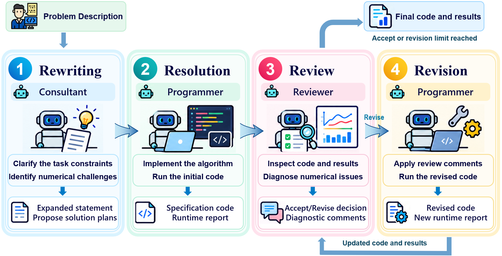

**From a scientific question to executable code — with the numerical decisions in view.**

[](docs/streamlit.md)
[](https://re4-agent.streamlit.app/)
[](docs/streamlit.md)
[](LICENSE)
[](https://openreview.net/forum?id=PMdr3fQpBE)

[Live demo](https://re4-agent.streamlit.app/) · [Explore the results](#results-from-the-archived-code) · [Run locally](#try-the-streamlit-app) · [Deploy](docs/deployment.md) · [Reproduce](docs/results_provenance.md) · [Cite](#citation)

</div>

Re4 combines three LLM roles — **Consultant, Programmer, and Reviewer** — in four stages. In **Rewriting**, the Consultant expands the problem context and proposes solution plans. During **Resolution**, the Programmer selects an approach, generates Python code, and executes it. **Review** examines the implementation and runtime results, optionally including figures; **Revision** uses the reviewer's feedback to update and rerun the code. Review and revision continue until acceptance or the configured iteration limit.

This repository includes the agent implementation, archived generated programs and interactions, and an interactive Streamlit workspace for inspecting their development and results. The focus is on the choices and difficulties revealed during solver development: discretization, stability, boundary conditions, array indexing, and consistency between coupled numerical steps. The examples use established benchmark problems; they do not demonstrate the discovery of new numerical methods.

## Results from the archived code

<div align="center">
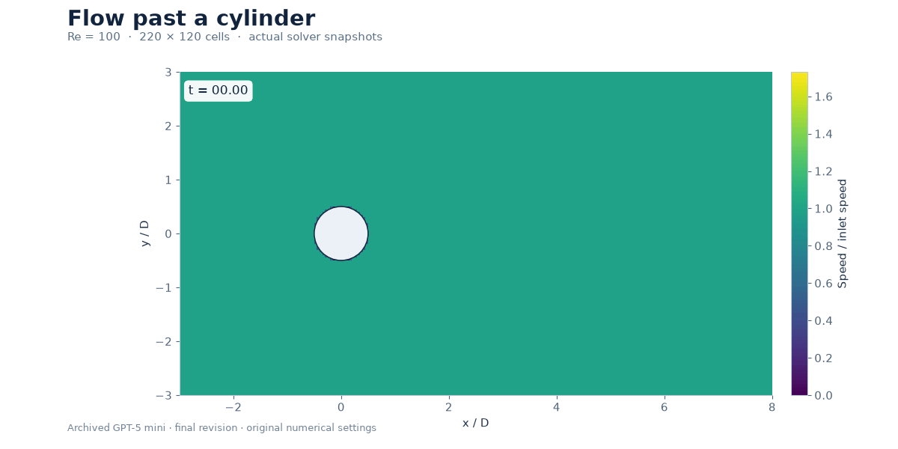

**Cylinder flow · Re = 100**  
Temporal snapshots regenerated from an archived final-revision program.
</div>

| Flow benchmarks | Transport and elliptic benchmarks | Algebra and dimensional analysis |
|:---:|:---:|:---:|
| **Sod shock tube**<br>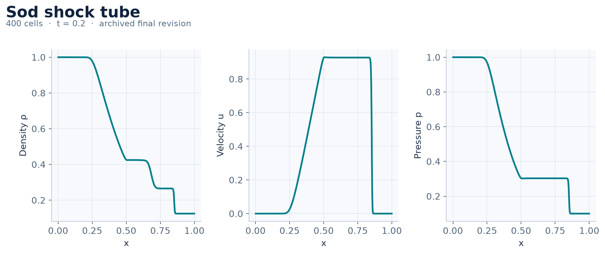 | **Viscous Burgers equation**<br>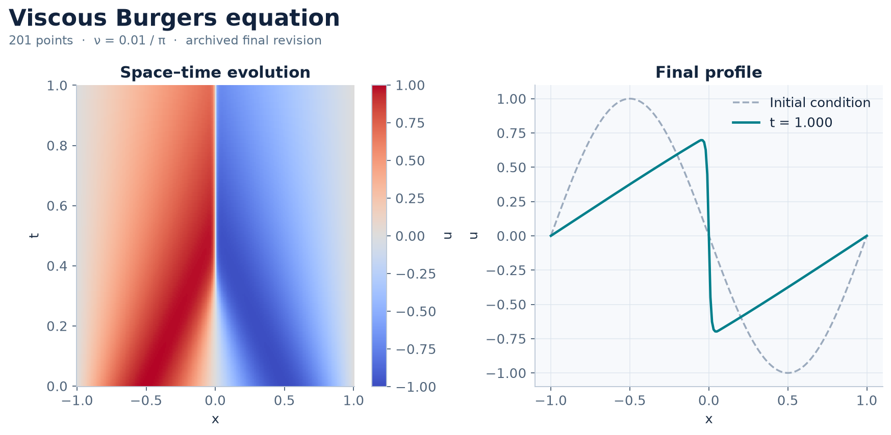 | **Hilbert system**<br>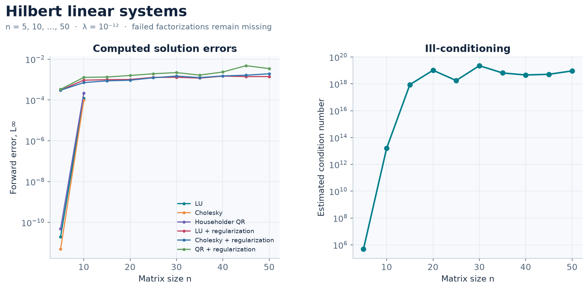 |
| **Lid-driven cavity**<br>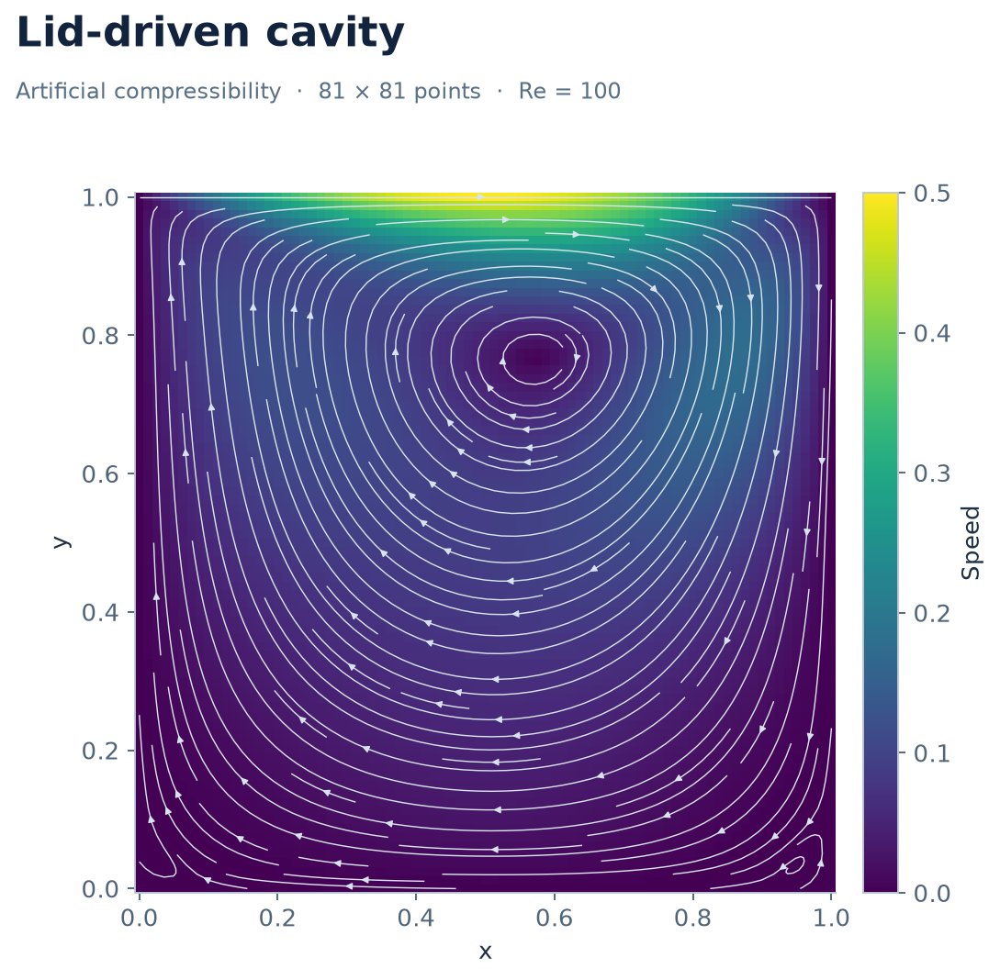 | **Poisson equation**<br>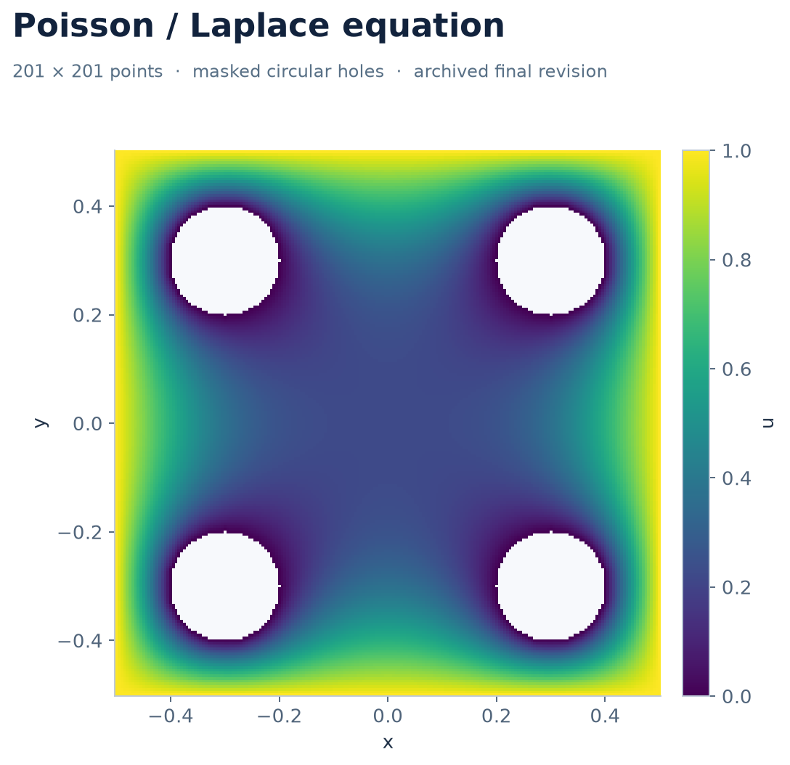 | **Keyhole scaling**<br>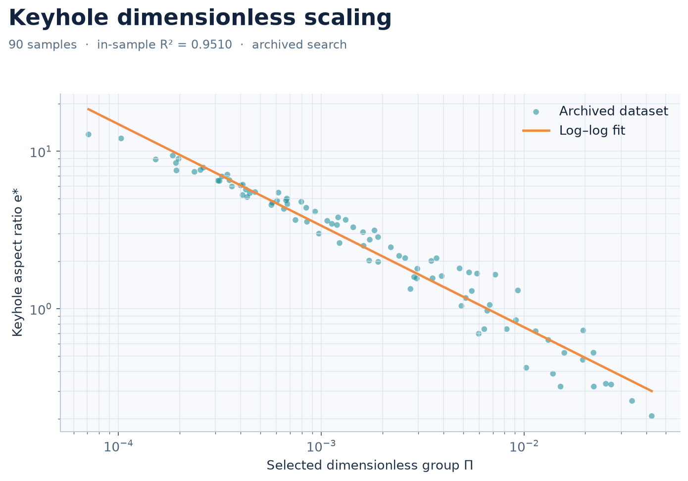 |
| **Unsteady Navier–Stokes**<br>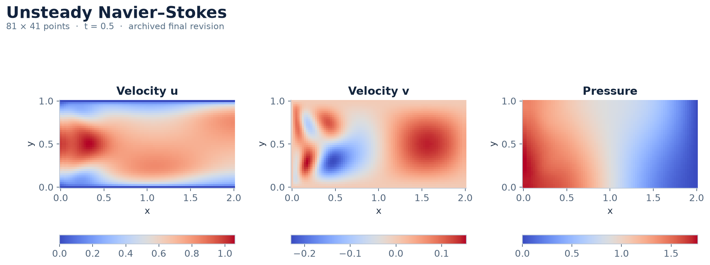 | **Helmholtz equation**<br>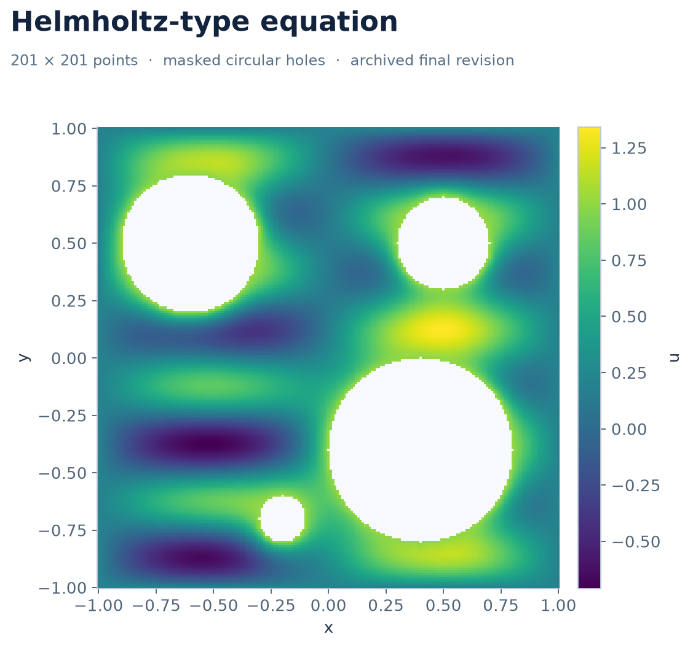 | **Rayleigh scaling**<br>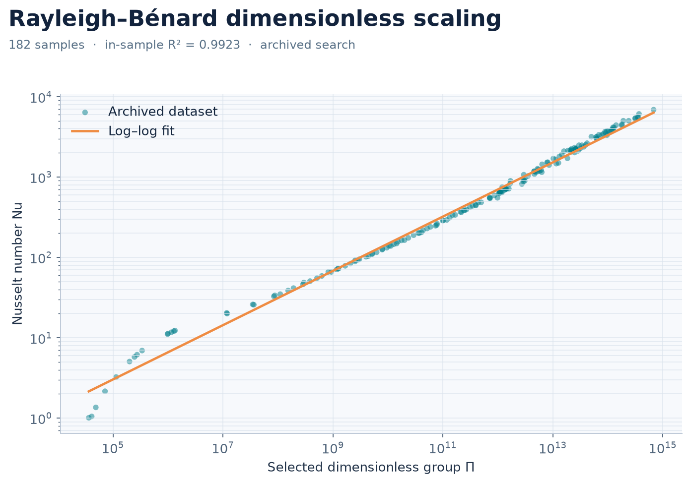 |

These are **selected regenerated examples**, not aggregate benchmark measurements. Each image is linked to its archived source and execution details in the [result provenance](docs/results_provenance.md). The Streamlit gallery exposes the corresponding code and available outputs; the replay view shows archived attempts and reviewer feedback. An executable program or a plausible plot alone does not establish numerical correctness.

## Try the Streamlit app

Open the [hosted Streamlit app](https://re4-agent.streamlit.app/) to explore the workspace, or follow the local setup below.

The default app works **without an API key**.

| Workspace | What you can inspect or run |
|---|---|
| **Gallery** | Numerical result cards, cylinder animation, source programs, and provenance. |
| **Replay** | Archived problem statements, Consultant plans, Programmer code, runtime output, and Reviewer feedback, presented in sequence. Replay makes no new LLM calls. |
| **Run lab** | Execute selected archived programs and inspect their logs and plots. Optional live mode connects the three roles to an OpenAI-compatible API. |

**Windows** — from this directory:

```powershell
.\start_streamlit.ps1
```

**macOS / Linux**, or manual setup:

```bash
python -m venv .venv
source .venv/bin/activate
python -m pip install -r requirements.txt
python -m streamlit run streamlit_app.py
```

After starting the app locally, open **http://localhost:8501** in your browser. See the [app guide](docs/streamlit.md) for a suggested walkthrough and optional live-model setup.

To deploy your own instance, use Streamlit Community Cloud or another Python hosting service. The [cloud deployment guide](docs/deployment.md) covers Streamlit Community Cloud and Docker-based deployment; a [Dockerfile](Dockerfile) is included. Hosting requires an account on the chosen platform.

## Repository map

```text
streamlit_app.py             Interactive workspace
re4_ui/                     Archive parsing and execution helpers
assets/results/             Regenerated gallery images, animation and manifest
tools/build_showcase.py      Reproduce the selected result assets
docs/                       App guide, deployment and result provenance
src/
├── pycodes_ver/             Original Python agent implementation
└── ipynb_ver/
    ├── *.ipynb              Original notebook versions
    └── sample_results/      Archived interactions, generated code and reference data
```

To regenerate the gallery after installing `requirements.txt`:

```bash
python tools/build_showcase.py
```

The original agent entry point remains `src/pycodes_ver/main.py`. It uses LangGraph, Pydantic response models, an OpenAI-compatible client, and the problem definitions in `problems.py`. Its optional dependencies are listed in `requirements-live.txt`; the [app guide](docs/streamlit.md) explains configuration and how the Streamlit view relates to the original implementation.

## Acknowledgements

The Streamlit interface, repository documentation, and visualization tooling were developed with assistance from OpenAI Codex.

## Citation

The workshop paper is available on [OpenReview](https://openreview.net/forum?id=PMdr3fQpBE). If this repository helps your research, please cite:

```bibtex
@inproceedings{cheng2026re,
  title={Re4: Scientific Computing Agent with Rewriting, Resolution, Review and Revision},
  author={Ao Cheng and Lei Zhang and Guowei He},
  booktitle={AI&PDE: ICLR 2026 Workshop on AI and Partial Differential Equations},
  year={2026},
  url={https://openreview.net/forum?id=PMdr3fQpBE}
}
```

Code is distributed under the [MIT License](LICENSE).
