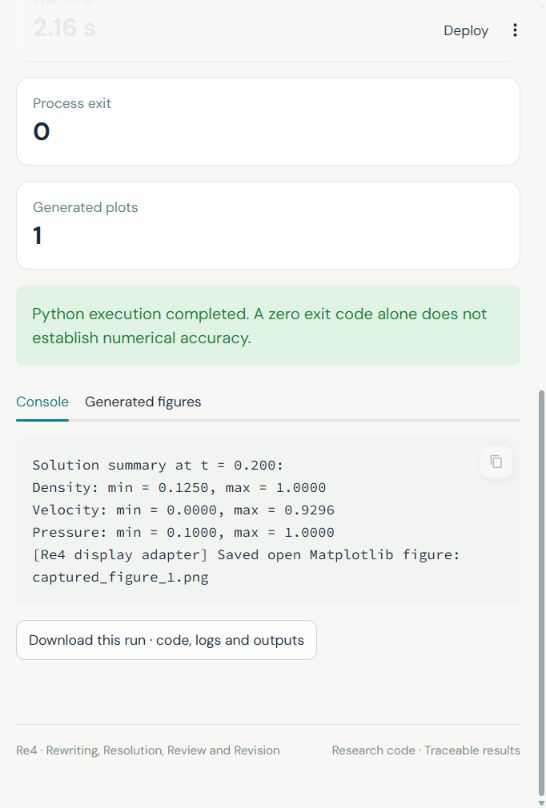
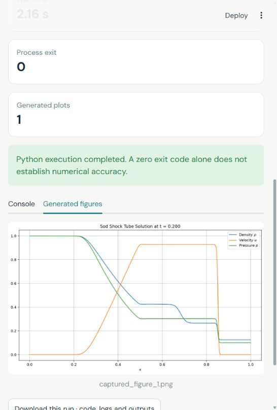

# Re4 interactive workspace

The Streamlit interface adds an inspection and execution layer around the code and records in `src/`. The default gallery and replay make no LLM requests.

## Start locally

Use Python 3.12, the version tested with the original source and the Streamlit adapter. On Windows, run `./start_streamlit.ps1` from PowerShell. The script reuses prepared local dependencies when available; otherwise it creates `.venv`, installs the core requirements and starts the app. If your PowerShell policy blocks local scripts, use the manual commands below rather than changing system policy.

```powershell
python -m venv .venv
.\.venv\Scripts\python.exe -m pip install -r requirements.txt
.\.venv\Scripts\python.exe -m streamlit run streamlit_app.py
```

On macOS/Linux:

```bash
python -m venv .venv
source .venv/bin/activate
python -m pip install -r requirements.txt
python -m streamlit run streamlit_app.py
```

The app is served at `http://localhost:8501`. To reuse an installed Windows environment, pass `-SkipInstall`; to choose a different Python executable or port, pass `-PythonPath` or `-Port`.

## Suggested walkthrough

1. Open **Gallery** and select cylinder flow. Watch the time sequence, inspect the final field, and open its source and provenance. Explore the other cases to see final numerical outputs.
2. Open **Replay** and choose an archived interaction. Follow the problem statement, candidate methods, implementation, runtime messages, and review feedback. The timeline presents text already stored in the repository; it is not a new model response.
3. Open **Run lab**, select an archived program, and run it. The page shows execution progress, captured console output, and generated figures. A fresh run can differ from the saved gallery if numerical-library versions or runtime settings differ.

The cylinder animation is a temporal sequence from a numerical rerun; it does not animate the agent's revision history. Agent revision history appears separately in Replay.

## Optional live-model runs

Install `requirements-live.txt` and enable execution of newly generated code on your own machine or private host:

```powershell
.\start_streamlit.ps1 -Live
```

Alternatively:

```powershell
.\.venv\Scripts\python.exe -m pip install -r requirements-live.txt
$env:RE4_ENABLE_LIVE_EXECUTION = "1"
.\.venv\Scripts\python.exe -m streamlit run streamlit_app.py
```

Enter an API key, an OpenAI-compatible endpoint and model names in the live-run form, or configure them through environment variables:

| Variable | Meaning |
|---|---|
| `OPENAI_API_KEY` | Provider key for live calls. |
| `RE4_API_BASE` | OpenAI-compatible API base URL. |
| `RE4_MODEL` | Shared default model identifier. |
| `RE4_CONSULTANT_MODEL` | Optional override for the Consultant. |
| `RE4_PROGRAMMER_MODEL` | Optional override for the Programmer. |
| `RE4_REVIEWER_MODEL` | Optional override for the Reviewer. |
| `RE4_ENABLE_LIVE_EXECUTION` | Set to `1` to allow the live agent to execute generated Python. |

Use the exact model identifiers supported by your provider. Live calls use the provider's structured-response support and may incur charges. The interface requests explicit acknowledgement before a new live run. `.env.example` documents the variables; it does not contain working credentials and is not loaded automatically.

The UI presents the same four-stage, three-role workflow. The original CLI remains in `src/pycodes_ver/main.py`; its role definitions and response schemas are preserved under `src/pycodes_ver/`. The Streamlit execution view captures runtime output and figures instead of relying on notebook display functions.

## Execution and numerical limits

The Replay, archived-solver and Live views use the same Python execution limits: 15, 30, 60, 120, 180, 300, 600, 1200 and 1800 seconds. The default is 600 seconds; the maximum is 1800 seconds (30 minutes) per Python execution. Choose a limit before starting a new run. Changing the selection does not resume or rerun an earlier execution. These options and limits are defined together in `re4_ui/execution.py`; the independent model API timeout is configured in `re4_ui/live.py`.

Archived programs are rerun in separate working directories with a timeout. Subprocess separation is not an operating-system sandbox: use a private deployment for new model-generated code. Keep live execution disabled on a public demonstration host. Gallery and Replay remain available without enabling it.

The result gallery contains selected examples. It does not recalculate the manuscript's aggregate success rates or errors, and it does not claim that each archived implementation is a validated reference solver. Consult [the provenance and numerical notes](results_provenance.md) before interpreting a result.

## Screenshots from the local run

The following screenshots were captured from the running app, including a fresh Sod solver execution (exit code 0 and one generated figure).

| Solver execution | Generated result |
|---|---|
|  |  |
